 

<!-- Troque os "#" pelos seus links quando tiver -->

  

<!--
## `~/sobre`

Escreva aqui um texto curto sobre você.
-->

## `~/stack`

  
  
  
  
  
  
  

<!--
## `~/trajetoria`

- ⚙️ Cargo · **Empresa** · 20XX – hoje
- 📘 Curso · **Faculdade** · 20XX – 20XX
-->

 

  

<picture>
  <source media="(prefers-color-scheme: dark)" srcset="https://raw.githubusercontent.com/Martinstein7/Martinstein7/output/snake-dark.svg"/>
  <source media="(prefers-color-scheme: light)" srcset="https://raw.githubusercontent.com/Martinstein7/Martinstein7/output/snake-light.svg"/>
  
</picture>

